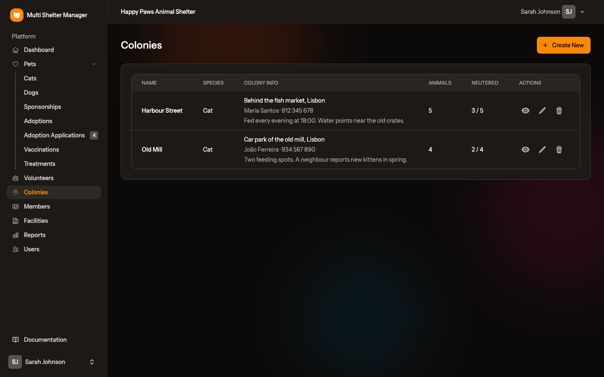
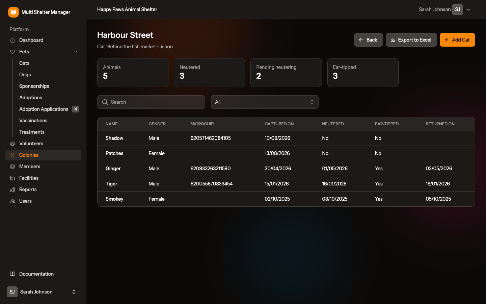

# 16. Colonies

[← Personal settings](15-settings.md) · [Documentation index](README.md)

> **Who:** Manager and Staff. Viewers see the location of a colony but never the caretaker or the notes.

Associations that look after free-roaming animals (usually cats), for example under CED/CER programmes (catch, neuter, return), can keep a record of each **colony**. An animal in a colony is a normal pet that lives there instead of in a cage.

## 16.1 Setting up

- The platform administrator marks the species that can live in colonies (usually only cats). The manager turns that species on for the shelter under **Settings → Shelter** ([15.5](15-settings.md)). If the colony form offers no species, one of these is missing.
- A shelter that does not need colonies switches the **Colonies** module off. Nothing is deleted.

## 16.2 The colonies list

**Colonies** in the sidebar lists, for each colony, its species, the **Colony info** (location and city, caretaker and phone, notes), how many animals it has and how many are neutered. Create, edit and delete colonies with the buttons on the page. Each colony has one species, which cannot change once it has animals, and an *active* flag.

## 16.3 The colony page

- The totals: animals, **Neutered**, **Pending neutering**, **No neutering info** and **Ear-tipped**. They always count the whole colony, whatever the filters show.
- Search the animals by name, reference or chip, and filter them by neutering situation or ear-tipped.
- The **Add …** button opens the pet form already set to the colony and its species.
- **Export to Excel** downloads all the colony's living animals (capture, neutering, ear-tip and return data) for the reports you send to the town hall.

## 16.4 Animals in a colony

In the pet form choose the **Colony** (only the colonies of the animal's species are offered) and fill in **Captured on**, **Returned on** and **Ear-tipped**. The cage field is then hidden. The animal keeps everything else: photos, vaccinations, treatments, diagnoses and neutering details. The colony is shown under **Accommodation** in the pets list and on the pet page, and can be used in the location filter of the pets list and of the group vaccination and group treatment forms.

Deleting a colony does not delete its animals: they stay registered without a colony and need a new location. The vaccination plan shows the colony as the location of a colony animal. The data export of the shelter includes the colonies.

---

[← Personal settings](15-settings.md) · [Documentation index](README.md)
